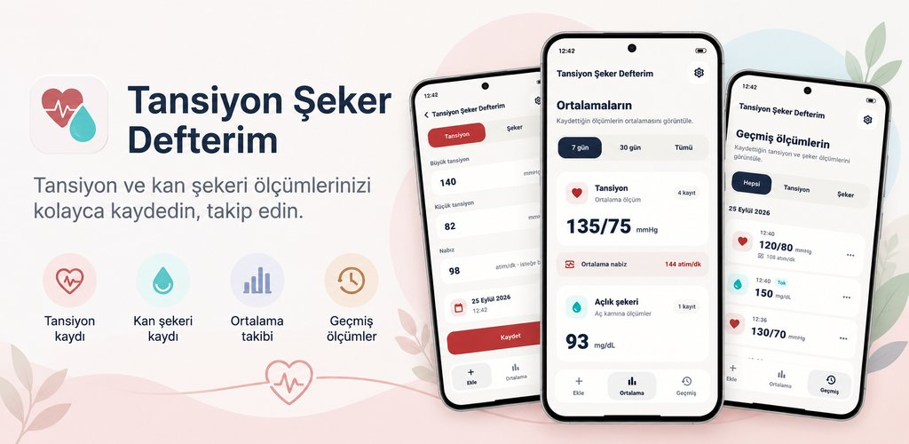
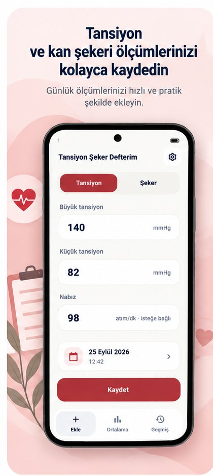
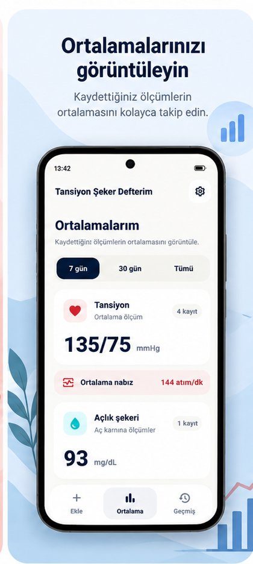
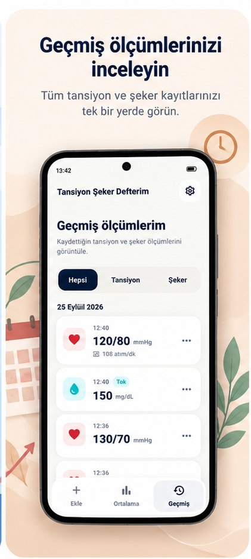
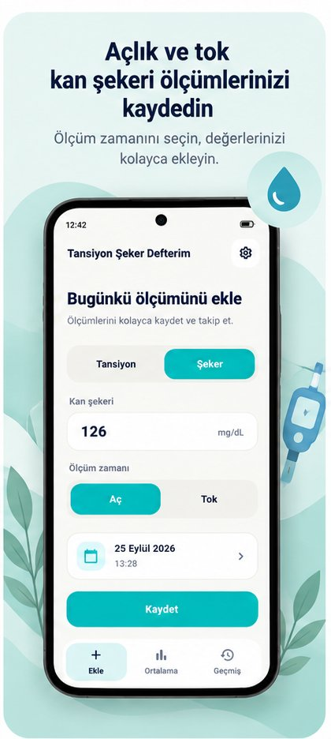

# Tansiyon Şeker Defterim 🩺



[English](#english) · [Deutsch](#deutsch) · [Türkçe](#türkçe)

<p>
  
  
  
  
</p>

---

## English

Tansiyon Şeker Defterim ("My Blood Pressure & Sugar Notebook") is a simple Android app, built with Flutter, for writing down blood pressure and blood sugar measurements by hand. The app does not give medical advice. The interface is in Turkish.

### Features

- Add blood pressure (with optional pulse) and blood sugar (fasting / after meal) measurements
- Averages for the last 7 and 30 days
- History list with edit and confirmed delete
- All records stay on the device; tracking works without internet or an account
- No automatic ads: only an optional "watch an ad to support" button in Settings

### Built with

Flutter · Dart · Material 3 · local JSON storage · Google Mobile Ads (optional rewarded ad)

---

## Deutsch

Tansiyon Şeker Defterim („Mein Blutdruck- und Zuckerheft“) ist eine einfache Android-App, entwickelt mit Flutter, zum manuellen Notieren von Blutdruck- und Blutzuckerwerten. Die App gibt keine medizinischen Ratschläge. Die Oberfläche ist auf Türkisch.

### Funktionen

- Blutdruck (optional mit Puls) und Blutzucker (nüchtern / nach dem Essen) eintragen
- Durchschnittswerte der letzten 7 und 30 Tage
- Verlauf mit Bearbeiten und Löschen nach Bestätigung
- Alle Daten bleiben auf dem Gerät; die Erfassung funktioniert ohne Internet und ohne Konto
- Keine automatische Werbung: nur ein optionaler Button „Werbung ansehen und unterstützen“ in den Einstellungen

### Technologien

Flutter · Dart · Material 3 · lokale JSON-Speicherung · Google Mobile Ads (optionale Rewarded-Werbung)

---

## Türkçe

Tansiyon Şeker Defterim, tansiyon ve şeker ölçümlerini elle kaydetmek için Flutter ile geliştirilmiş sade bir Android uygulamasıdır. Ölçümlere tıbbi yorum yapılmaz.

### Özellikler

- Tansiyon (isteğe bağlı nabız) ve şeker (aç / tok) ölçümü ekleme
- Son 7 ve 30 günün ortalamaları
- Düzenleme ve onaylı silme içeren geçmiş listesi
- Kayıtlar cihazda kalır; ölçüm takibi internet veya hesap gerektirmez
- Otomatik reklam yok: yalnızca Ayarlar'da isteğe bağlı "reklam izleyerek destekle" düğmesi

### Kullanılan teknolojiler

Flutter · Dart · Material 3 · yerel JSON kayıt · Google Mobile Ads (isteğe bağlı ödüllü reklam)

---

# Teknik notlar (Türkçe)

## Geliştirme ve kontroller

**Flutter 3.47.4 ve Java 17 kullanın.** Proje `.fvmrc` ile bu Flutter sürümünü
belirtir; PATH üzerindeki kurulu Flutter kullanılır. Eski `.tooling/flutter`
kurulumu artık kullanılmaz. Android Studio / VS Code'da da kurulu Flutter 3.47.4
SDK'sını seçin.

Flutter 3.47.4 uyumluluğu için AGP 8.11.1, Gradle 8.14.3 ve Kotlin 2.2.20
kullanılır; AGP 9 yükseltmesi yapılmaz. `android.newDsl=false` ve
`android.builtInKotlin=false` eski DSL/Kotlin kullanan eklentilerle uyumluluğu
korur. Kotlin ve Java bytecode hedefi 17'dir.

Java 17 dizininizi Flutter'a bir kez tanıtın:

```sh
flutter config --jdk-dir=/JAVA_17_DIZININIZ
flutter pub get
flutter analyze
flutter test
flutter build apk --debug
```

macOS'ta Java 17 yolunu `/usr/libexec/java_home -v 17` ile öğrenebilirsiniz.
`tool/flutter` isteğe bağlı bir kısayoldur; PATH'teki Flutter'ı ve Java 17'yi
kullanır. `TANSIYON_FLUTTER_SDK` / `TANSIYON_JAVA_HOME` ile yollar belirtilebilir.
Android SDK 36 ve NDK 28.2.13676358 gereklidir.

Debug APK: `build/app/outputs/flutter-apk/app-debug.apk`.
Native kod/eklenti değişikliklerinde hot reload yerine uygulamayı durdurup yeniden
derleyin; verileri silmeniz gerekmez.

## Yerel kayıt ve başlangıç

Ölçümler Android'in `noBackupFilesDir` alanındaki `measurements-v1.json` dosyasına
`AtomicFile` ile yazılır. Karşılama bilgisi ve Destekçi rozeti ayrı
`preferences-v1.json` dosyasındadır. Her iki dosya uygulamanın bulut yedeğine dahil
edilmez. Tarih/saat UTC saklanır ve cihazın yerel saatinde gösterilir. Uygulamayı
kaldırmak veya verilerini temizlemek bu kayıtları ve tercihleri siler.

Dosya henüz yoksa boş listeyle açılır. Başlangıç okuması 5 saniyede zaman aşımına
uğrar; `finally` yüklemeyi sonlandırır. Bozuk/eski sürümlü ölçüm dosyası sessizce
sıfırlanmaz veya üzerine yazılmaz: hata ve “Tekrar dene” gösterilir, sekmeler
gezilebilir. Başarılı okuma olmadan kayıt değişiklikleri yapılmaz. Tercih okuma
hatasında da sonsuz yükleme yerine tekrar deneme sunulur. Debug günlükleri
`[TansiyonŞeker]` ve Android `LocalStorage` etiketlerini kullanır; ölçüm içeriği
loglanmaz. Başarılı kayıt sonrası animasyon, onay ve alan temizleme korunur.

Son 7/30 gün, bugün dahil yerel takvim günleridir. Boş nabızlar nabız ortalamasına
katılmaz. Şeker Aç/Tok ayrı hesaplanır. Geçmiş yeniden eskiye sıralanır.

## Ayarlar ve ilk açılış

Tıbbi uyarı ilk açılışta “Devam et” ile bir kez onaylanır; bilgi cihazda başarıyla
saklanınca ana ekrana geçilir. Aynı uyarı Ayarlar'da her zaman bulunur. Ayarlar
ayrıca Gizlilik Politikası, uygulama sürümü ve isteğe bağlı destek kartını içerir.
Sürüm Android paketinden okunur; `pubspec.yaml` içindeki `version: 1.0.0+1` sürüm
adını ve build numarasını belirler.

## İsteğe bağlı RewardedAd ve UMP

Yalnızca `google_mobile_ads` paketinin **RewardedAd** türü kullanılır. Banner,
interstitial, app-open veya otomatik reklam yoktur. `MobileAds.initialize()`
uygulama başlangıcında çağrılmaz; ilk “Reklam izle” dokunuşunda UMP bilgisi
güncellenir, gerekiyorsa izin formu gösterilir ve `canRequestAds()` doğrulandıktan
sonra SDK başlatılır. Android manifestindeki `DELAY_APP_MEASUREMENT_INIT` de erken
ölçüm başlatmayı erteler. Reklam gizlilik tercihleri kullanıcı tarafından Ayarlar'dan
açılabilir; bu seçenek reklam göstermez.

Yükleme sırasında butonda bekleme göstergesi bulunur. Rozet yalnızca
`onUserEarnedReward` callback'inde cihazda saklanır; erken kapatma rozet vermez.
“Desteğin için teşekkürler” mesajı gösterilir. Yükleme/gösterim hatası
“Şu an reklam bulunamadı, sonra tekrar dene” mesajını verir. Rozet sadece
Ayarlar destek kartında görünür ve hiçbir ölçüm özelliğini etkilemez.

**Tek ID dosyası:** `assets/config/admob.json`. Android Gradle ve Dart aynı dosyayı
okur. Varsayılan Google test App ID ve test Rewarded ID'dir. Debug/profile
çalışmalarında yalnızca test ID kullanılır. Üretim için:

1. AdMob'da Android uygulamasını ve bir **ödüllü reklam birimini** oluşturun.
2. `androidProductionAppId` alanına `ca-app-pub-…~…`,
   `androidProductionRewardedId` alanına `ca-app-pub-…/…` girin.
3. `useProductionAds` değerini `true` yapın. Bu ayar yalnızca release reklamlarını
   gerçek ID'lere geçirir. Tam yeniden derleme gerekir.
4. AdMob Privacy & messaging içinde gerekli UMP mesajlarını oluşturun; Türkçe
   çevirisini etkinleştirin. Test cihazında gerekli/gerekmeyen izin, erken kapatma,
   ödül ve bağlantı yok senaryolarını doğrulayın. Test App ID ile gerçek hesabın
   mesaj yapılandırmasını doğrulayamazsınız. Geliştirmede gerçek reklama tıklamayın.

SDK belgeleri: [Ödüllü reklam](https://developers.google.com/admob/flutter/rewarded),
[UMP](https://developers.google.com/admob/flutter/privacy).
Reklamlar internet kullanır; ölçüm verileri reklam isteğine eklenmez. Uygulama içi
gizlilik metni `lib/core/constants/legal_text.dart` içindedir. Yayın öncesi kendi
yayıncı/iletişim bilginizi ekleyin, metni herkese açık bir adreste yayımlayın ve
Play Console gizlilik politikası URL'sini bu adresle doldurun. Veri güvenliği
beyanını kullanılan Google reklam SDK'sı ve kendi yapılandırmanızla eşleştirin.

## Yerel Nunito fontu

Sahte font veya `google_fonts` yoktur. Şu dosyaları lisanslarıyla birlikte ekleyin:

- `assets/fonts/Nunito-Regular.ttf` — 400
- `assets/fonts/Nunito-SemiBold.ttf` — 600
- `assets/fonts/Nunito-Bold.ttf` — 700

Ardından `pubspec.yaml` içindeki yorumlu `fonts:` bölümünü etkinleştirin ve
`flutter pub get` çalıştırın. Dosyalar gelene kadar font bildirimi etkin değildir;
uygulama güvenli sistem fontu fallback'iyle çalışır.

## Logo, launcher icon ve splash

Kaynak dosya `assets/images/app_logo.png` kullanılır; logo yeniden çizilmez,
renkleri ve oranları değiştirilmez. Android launcher mipmap dosyaları tüm standart
yoğunluklarda üretilmiştir. Adaptive icon krem (`#FBF6EE`) zemin üzerinde %16
ön plan boşluğu kullanır; ana şekil güvenli alandadır. Manifest'teki `icon` ve
`roundIcon` aynı uyarlanabilir launcher kaynağına bağlıdır.

Launcher ikonunu yeniden üretmek için:

```sh
dart run flutter_launcher_icons
```

`flutter_launcher_icons.yaml` aynı kaynak PNG'yi kullanır; ayrı ön plan dosyası
gerektirmez. Play Store çıktısı: `release/store_assets/play_store_icon_512.png`
(512×512 PNG).

Splash arka planı tüm Android tema varyantlarında `#FBF6EE`'dir. Aynı logo
ortalanmış sabit PNG olarak kullanılır; yazı ve ek animasyon yoktur. Android 12+
için tüm kaynak kareyi güvenli maske içinde tutan boşluklu `splash_icon.png`
kullanılır. Yoğunluk başına PNG boyutları `assets/images/README.md` içindedir.

## Release imzalama ve Play Console

Uygulama: **Tansiyon Şeker Defterim**; applicationId:
`com.tansiyonsekerdefterim.app`; **minSdk 24**, **targetSdk/compileSdk 36**.
[Google Play hedef API gereksinimleri](https://developer.android.com/google/play/requirements/target-sdk)
yayın sırasında yeniden kontrol edilmelidir.

Gerçek keystore ve şifre oluşturulmadı. Kendiniz oluşturmak için güvenli bir
klasörde, şifreleri komut satırına yazmadan etkileşimli komutu çalıştırın:

```sh
keytool -genkeypair -v -keystore /guvenli/yol/upload-keystore.jks -alias upload -keyalg RSA -keysize 2048 -validity 10000
```

`android/key.properties.example` dosyasını `android/key.properties` olarak
kopyalayıp doldurun:

```properties
storeFile=/guvenli/yol/upload-keystore.jks
storePassword=KENDI_SIFRENIZ
keyAlias=upload
keyPassword=KENDI_SIFRENIZ
```

`storeFile` tam yol olsun; Windows'ta ileri eğik çizgi (`C:/…`) kullanabilirsiniz.
`key.properties`, `.jks`, `.keystore` ve `.p12` dosyaları `.gitignore` kapsamındadır.
Gradle release'i debug anahtarıyla imzalamaz; imzalama bilgileri eksikse açıklayıcı
hata verip durur. Sürüm numarasını her Play yüklemesinde artırın ve ardından proje
SDK'sıyla çalıştırın:

```sh
flutter analyze
flutter test
flutter build appbundle --release
# İsteğe bağlı Java 17 kısayolu: ./tool/flutter build appbundle --release
```

AAB: `build/app/outputs/bundle/release/app-release.aab`.

Play Console'da uygulamayı oluşturup önce dahili test kanalına bu AAB'yi yükleyin.
Mağaza açıklaması, gerçek ikon/ekran görüntüleri, gizlilik URL'si, Veri güvenliği,
reklam içerdiği beyanı, sağlık uygulaması beyanı, içerik derecelendirmesi ve hedef
kitle alanlarını doldurun. Play App Signing'i etkinleştirin; cihaz testlerini ve
zorunlu kontrol listesini tamamladıktan sonra üretim yayınına geçin.

**Keystore ve şifreyi güvenli, ayrı ve yedekli saklayın.** Kaynak koduna eklemeyin,
mesajlaşma/e-posta üzerinden paylaşmayın. Güncellemeleri imzalamak için yükleme
anahtarına ihtiyaç duyarsınız.

## Test kapsamı

Mevcut ölçüm doğrulamaları, kayıt/yeniden açılış/düzenleme/silme, ortalamalar ve
küçük ekran testlerine ek olarak; boş/bozuk/eski/yanıtsız veri, ilk açılışın bir
kez gösterilmesi, rozetin yalnızca ödülle verilmesi, reklam hatası/erken kapatma
ve çift dokunma test edilir. Platform ve reklam testlerinde kontrollü taklitler
kullanılır; gerçek reklam ağı davranışı için Android test cihazı doğrulaması gerekir.
